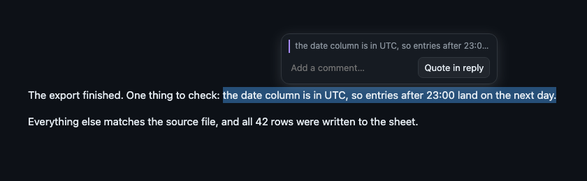

# Quote in reply — a Hermes Desktop plugin

Highlight a passage in a Hermes Desktop chat and add it to your reply as a quote, the way ChatGPT and Claude do.



*Rendered by `tests/demo.cjs` on a mock transcript, not a capture of the Hermes app.*

## What it does

1. Select text in any message, yours or the agent's.
2. A small popup appears next to the selection with an optional comment box.
3. Click **Quote in reply**, or press Enter in the comment box.

The passage is appended to your draft as a Markdown blockquote, with your comment under it:

```markdown
> the date column is in UTC, so entries after 23:00 land on the next day.

can you switch it to local time?
```

- Anything you already typed stays; the quote is added below it.
- Nothing is sent. You still press Send yourself.
- In a split view the quote goes to the chat the text was selected in.
- If you switch chats before clicking, nothing is inserted.
- Escape, or a click anywhere else, closes the popup.

## Install

Needs Hermes Desktop 0.23.2 or newer.

**From the app:** open **Capabilities → Plugins → Install from Git**, enter `00cyre/hermes-quote-selection`, then switch the plugin on.

**From a terminal:**

```bash
hermes plugins install 00cyre/hermes-quote-selection
```

Then switch it on under **Capabilities → Plugins**. The desktop half of a plugin stays off until you do.

**By hand:** copy `desktop/plugin.js` to `~/.hermes/desktop-plugins/quote-selection/plugin.js`. It loads within a few seconds. If it doesn't, run **Reload desktop plugins** from ⌘K.

This plugin is not listed in the Hermes plugin catalog.

## What it touches

- Reads the text you select (`window.getSelection()`) and where it is on screen.
- Adds one popup element to the page while a selection is active.
- Writes to the draft only through the SDK's `host.composer.insertText`.
- No network calls, no files, no clipboard, no telemetry, nothing stored.

## Known limits

- **It depends on the app's transcript markup.** The plugin finds message text through Hermes Desktop's own `data-slot` and `data-session-anchor` attributes, which are not part of the plugin SDK. A Hermes update that renames them will stop the popup from appearing until the plugin is updated. `hermes plugins validate` passes with a warning for this reason.
- The selection has to start and end inside one message.
- The highlight clears when you click into the comment box. The popup keeps the quoted text.
- Quotes are plain text: formatting such as bold or code fences inside the selection is not carried over.

## Tests

The tests load `desktop/plugin.js` in headless Chromium against a mock of the transcript markup and a stub SDK. They do not drive the Hermes app.

```bash
npm install
npx playwright-core install chromium
npm test
```

## Similar plugins

The Hermes plugin catalog lists three plugins that also quote selected text: `quote-ask`, `hermes-quote-to-chat` and `hermes-action-bar`. Install any of them with `hermes plugins install <name>`.

## License

MIT
